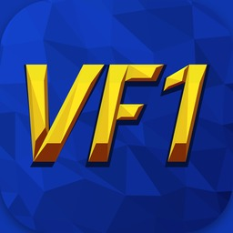

<p align="center"></p>

<h1 align="center">Virtua Fighter Recomp NX</h1>

<p align="center"><b>Virtua Fighter (SEGA, arcade, Model 1, 1993) for the Nintendo Switch: the arcade's own V60 code
recompiled to native code, as a homebrew <code>.nro</code>.</b></p>

A Nintendo Switch port of [Virtua Fighter Recomp](https://github.com/mr-finster/vf1-recomp) by
[mr-finster](https://github.com/mr-finster), built with devkitPro (devkitA64, libnx, switch-sdl2).

## No ROMs, nothing from SEGA

**This repository contains no ROMs, no game data, no code or assets from SEGA, and nothing made from
them.** It is only source code. To build and play it you need your own legal dump of the game as
MAME's `vf` set (`vf.zip`).

The game's code is recompiled from **your** `vf.zip` on **your** PC, so the `.nro` you build contains
code derived from the ROM: it is for your own use only. **Don't share it**, and don't ask for ROMs or
ready-made builds: none will be provided.

This is an unofficial fan project. It is not made, approved, endorsed or supported by SEGA or
Nintendo, and is not affiliated with them. Virtua Fighter is a trademark of SEGA. Nintendo Switch is
a trademark of Nintendo.

## Features

- The arcade game recompiled to native ARM64 code (no emulation of the V60 CPU at run time)
- The arcade's own picture at 1x, with higher render scales available in the menu
- Widescreen and the arcade's 4:3, scanline and CRT screen filters
- The in-game menu: display, sound, arcade settings (difficulty, ring size, rounds), controls
- Rankings and arcade settings saved to the SD card
- Two players, with any controllers the Switch supports

## Building

You need Linux or WSL (Windows Subsystem for Linux) with [devkitPro](https://devkitpro.org/wiki/Getting_Started)
installed, and your own `vf.zip`.

1. Install the Switch libraries and the PC's own compilers:

   ```
   sudo dkp-pacman -S switch-dev switch-sdl2 switch-freetype switch-zlib
   sudo apt install build-essential python3 git
   ```

2. Get the source and build:

   ```
   git clone https://github.com/toniisound/vf1-recomp-nx
   cd vf1-recomp-nx
   tools/switch/build.sh path/to/vf.zip
   ```

   If you also have MAME's `model1io.zip` (the real I/O board's program), add it after `vf.zip`.

3. The result is `build/switch/vf1-recomp-nx.nro`.

What `tools/switch/build.sh` does:

1. `tools/romset.py` checks your `vf.zip` and writes its memory regions to `build/vf`;
2. the recompiler (`tools/recomp`) turns the game's V60 code into C++ (`build/gen/vf_rec.cpp`), using
   the address map in `assets/vf_map.txt`;
3. `make -f Makefile.switch` builds everything for the Switch.

Everything made from the ROM stays in `build/`, which is never committed.

## Installing

Copy to your SD card:

```
/switch/vf1-recomp-nx/vf1-recomp-nx.nro
/switch/vf1-recomp-nx/roms/vf.zip
/switch/vf1-recomp-nx/roms/model1io.zip     (optional)
```

Start it from the Homebrew Menu. Use title takeover (hold R while starting a game) for the full
memory and CPU time; applet mode (the Album) is not recommended.

Settings, saves and `log.txt` are kept in `/switch/vf1-recomp-nx/`. If `vf.zip` is missing, the game
tells you where to put it.

## Controls

| Switch | Game |
| --- | --- |
| Left stick / D-pad | Move |
| Y | Guard |
| B | Punch |
| A | Kick |
| X | Guard + Punch (throws) |
| R | Punch + Kick |
| L | Guard + Kick |
| ZR | All three |
| + | Start |
| − (tap) | Menu |
| − held + L | Change the render scale |
| − held + R | Change the picture shape |

In the menu, A chooses and B goes back. The buttons can be changed in Menu > Controls.

## Performance

- **Render thread** (Menu > Display, on by default): each picture is drawn on cores 1 and 2 while
  the game runs its next frames on core 0, instead of one after the other. It needs the game started
  with title takeover (hold R while starting a game). If you ever see something wrong in the
  picture, turn it off (it takes effect from the next start) and report it.
- **CPU boost** (Menu > Display, on by default): the CPU at 1785 MHz instead of 1020, the console's
  own boost mode. Title takeover only; it uses more battery.
- The game starts at 1x, the arcade's own 496 x 384, because the Switch's CPU draws the 3D. Higher
  render scales are in Menu > Display > Render scale; if the console can't keep up, the game lowers
  it by itself.
- `frame_timings = 1` in `settings.ini` writes the frame rate and where each picture's time goes
  to `log.txt`, every two seconds.

## How it works

The original game is built on SDL 3, whose Switch port is only available to licensed developers.
Homebrew has SDL 2, so `src/host/sdl3_compat.h` provides the part of SDL 3 the game uses on top of
SDL 2. The game's own code is unchanged apart from a few `__SWITCH__` lines, which keeps it easy to
bring in new versions of the original.

- The game's code is recompiled ahead of time to C++ on your PC (the Switch can't recompile it at
  run time), and that C++ is compiled into the `.nro`.
- The 3D is drawn by the CPU, on cores 1 and 2 while the game runs on core 0; the picture is put
  together and scaled by the GPU through SDL's OpenGL ES renderer.

## Updating from the original

New versions of mr-finster's project can be brought in with git:

```
git remote add upstream https://github.com/mr-finster/vf1-recomp
git pull upstream main
```

If the original adds new source files, `Makefile.switch`'s source lists may need them too.

## Credits

**All the credit for Virtua Fighter Recomp goes to its developer, [mr-finster](https://github.com/mr-finster).**
The recompilation of the arcade's V60 code, the Model 1 board rebuilt around it, the render scales,
widescreen, smooth motion, the menu and everything else that makes the game run are his work. This
port only brings it to the Switch.

- Original project: [mr-finster/vf1-recomp](https://github.com/mr-finster/vf1-recomp)
  (PC, Mac and Steam Deck: <https://vf1-recomp.pages.dev/>)
- Built on MAME's work on the Model 1: the V60 core and disassembler (Farfetch'd, R. Belmont), the
  TGP, the rasterizer, the System 24 tile chip and the machine (Olivier Galibert), the MultiPCM
  (Miguel Angel Horna) and the sound board (R. Belmont)
- Musashi (Karl Stenerud), ymfm (Aaron Giles), the Z80 core (Nicolas Allemand), RmlUi, GLM,
  stb_image (Sean Barrett), SDL (Sam Lantinga and contributors), FreeType, and the Barlow Condensed
  font
- devkitPro, libnx and the Switch homebrew community
- Nintendo Switch port: **Toniisound**

## License

MIT for this project's own code: see [LICENSE](LICENSE). Code from MAME keeps its BSD-3-Clause
licence and notices; the rest of `third_party/` keeps its own.

## Support

This emulator is completely free and open-source. Optional donations to support the development are always welcome:

[](https://ko-fi.com/toniisound)
[](https://paypal.me/toniisound)
